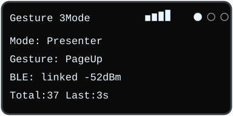
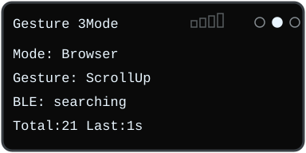

# Gesture3Mode – 三模式手势控制器

基于 **ESP32-D0WD 经典 ESP32（4MB Flash）** 与 **PAJ7620U2** 手势传感器的 **BLE HID 复合设备**，支持三种工作模式（演示 / 浏览 / 媒体），可通过 BOOT 键循环切换，适用于 PPT 演讲、网页浏览、影音播放等桌面近场交互场景。

---

## 目录

- [项目概述](#项目概述)
- [硬件设计](#硬件设计)
- [软件依赖](#软件依赖)
- [三模式手势映射表](#三模式手势映射表)
- [OLED 显示](#oled-显示)
- [OLED 刷新策略](#oled-刷新策略最稳妥方案)
- [上电自检流程](#上电自检流程)
- [关键代码说明](#关键代码说明)
- [测试数据](#测试数据)
- [使用说明](#使用说明)
- [已知问题与局限性](#已知问题与局限性)
- [未来改进方向](#未来改进方向)
- [附录](#附录)

---

## 项目概述

本项目利用 PAJ7620U2 红外手势传感器捕捉 9 种手势（上、下、左、右、靠近、远离、顺时针、逆时针、挥手），通过 ESP32-D0WD 解析后转换为 BLE HID 键盘/消费者控制/鼠标报告，实现对电脑或手机的无线操控。

**核心特点：**
- 三模式独立映射，覆盖 PPT 演示、网页浏览、媒体控制三大场景
- Presenter / Browser / Media 三种模式通过 BOOT 按键循环切换，OLED 显示当前模式与最近一次已处理手势
- 蓝牙信号强度（RSSI）可视化，手势计数与时间统计
- 手势防抖（250ms 冷却）与连续触发（音量/滚轮 5 次连发）
- 上电自检流程，逐项显示硬件状态
- 按测试表原始次数计算的平均识别率为 91.1%（5~15cm 范围）

---

## 硬件设计

### 元器件清单

| 组件 | 型号/规格 | 数量 |
|---|---|---|
| 主控 | ESP32-D0WD 经典 ESP32（4MB Flash） | 1 |
| 手势传感器 | PAJ7620U2 (I²C 地址 0x73) | 1 |
| OLED 显示屏 | 0.96 寸 128×64, I²C 地址 0x3C | 1 |
| 蜂鸣器 | 有源或无源（LEDC PWM 4kHz） | 1 |
| 按键 | 轻触开关（BOOT 键，GPIO0） | 1 |
| 电源 | 3.3V 稳压（USB 供电或锂电池） | 1 |

### 接线图


- OLED SSD1306 与 PAJ7620U2 共用 I²C：SDA 接 GPIO21，SCL 接 GPIO22；地址分别为 0x3C 和 0x73。
- 两个模块均接 3.3V 和公共 GND。PAJ7620U2 默认 I²C 地址为 0x73（AD1 引脚悬空或接 GND）。
- 无源蜂鸣器模块的 I/O 接 GPIO5，VCC 接 3.3V，GND 接公共地；GPIO5 输出 4kHz PWM。裸蜂鸣器应按器件规格确认 GPIO 驱动能力，必要时加三极管驱动。
- 使用开发板板载 BOOT 键（GPIO0，内部上拉，按下为 LOW），无需额外接按键。
- 若模块没有板载上拉，SDA、SCL 各接 4.7kΩ 至 3.3V；PAJ7620U2 的 PS 跳线断开时，VL 脚单独接 3.3V。

---

## 软件依赖

- **开发环境**：Arduino IDE 2.x / PlatformIO
- **ESP32 支持包**：esp32 by Espressif Systems (≥ 2.0.14)
- **手势库**：[RevEng_PAJ7620](https://github.com/acrandal/RevEng_PAJ7620) @ ^1.5.0
- **BLE 库**：NimBLE-Arduino 2.x（已集成于 ESP32 支持包，或单独安装）
- **OLED 库**：Adafruit SSD1306 + Adafruit GFX（或 u8g2）

### Arduino IDE 库管理器安装

```
RevEng_PAJ7620 by Aaron S. Crandall  version 1.5.0
Adafruit SSD1306                     version 2.5.7
Adafruit GFX Library                 version 1.11.5
```

---

## 三模式手势映射表

### 模式一：演示（Presenter）

| 手势 | HID 行为 | 用途 |
|---|---|---|
| 左滑 | PageUp (0x4B) | 上一页 |
| 右滑 | PageDown (0x4E) | 下一页 |
| 上滑 | Tab (0x2B) | 切换到下一个链接/控件 |
| 下滑 | Shift+Tab (0x2B + modifier) | 切换到上一个链接/控件 |
| 靠近 | Enter (0x28) | 打开选中的链接/确认 |
| 远离 | 空操作 | 无动作 |
| 顺时针 | Consumer VOL+ (0xE9) ×3 | 音量加 |
| 逆时针 | Consumer VOL- (0xEA) ×3 | 音量减 |
| 挥手 | Consumer Mute (0xE2) | 静音切换 |

### 模式二：浏览（Browser）

| 手势 | HID 行为 | 用途 |
|---|---|---|
| 左滑 | 鼠标滚轮上滚 ×5 | 页面上滚 |
| 右滑 | 鼠标滚轮下滚 ×5 | 页面下滚 |
| 上滑 | Tab (0x2B) | 切换到下一个链接/控件 |
| 下滑 | Shift+Tab | 切换到上一个链接/控件 |
| 靠近 | Enter (0x28) | 打开选中的链接 |
| 远离 | Ctrl + R（修饰符 `KEY_MOD_LEFT_CTRL`，键码 `0x15`） | 返回上一级 |
| 顺时针 | Ctrl+Shift+= (键码 0x2E，modifier 0x03) | 放大页面（依赖键盘布局） |
| 逆时针 | Ctrl+- (键码 0x2D，Ctrl modifier 0x01) | 缩小页面 |
| 挥手 | Home (0x4A) | 回到页面顶部 |

### 模式三：媒体（Media）

| 手势 | HID 行为 | 用途 |
|---|---|---|
| 上滑 | Consumer VOL+ ×5 | 快速增大音量 |
| 下滑 | Consumer VOL- ×5 | 快速减小音量 |
| 左滑 | Consumer Scan Next Track (0x00B5) | 下一首 |
| 右滑 | Consumer Scan Previous Track (0x00B6) | 上一首 |
| 靠近 | Consumer Play/Pause (0xCD) | 播放/暂停 |
| 远离 | 空操作 | 无动作 |
| 顺时针 | 右箭头 ×3 (键码 0x4F) | 快进（约 15 秒，具体步长取决于播放器） |
| 逆时针 | 左箭头 ×3 (键码 0x50) | 快退（约 15 秒，具体步长取决于播放器） |
| 挥手 | Consumer Mute (0xE2) | 静音切换 |

> **设计原则**：模式一（演示）/模式二（浏览）共享 Tab/Shift+Tab 的上下滑逻辑，降低用户记忆成本；模式三中上下滑提供快速音量调节（每次手势重复 5 次），左/右滑切换曲目，顺/逆时针以重复方向键实现快进/快退。方向键的单次 seek 时长由播放器决定，约 15 秒并非所有播放器都保证。

---

## OLED 显示

OLED 屏幕（128×64）实时显示以下信息：

### 已连接蓝牙（信号良好）



### 未连接蓝牙



### 各行含义

| 行号 | 内容 | 说明 |
|---|---|---|
| 第 1 行 | 标题 + 信号格 + 模式圆点 | 右侧信号格 4 格，按 RSSI 动态填充（≥-50 dBm → 4 格、≥-65 → 3 格、≥-80 → 2 格、更弱 → 1 格；未连接时 4 格全部空心）；3 个圆点对应三种模式（实心 = 当前模式：1=Presenter, 2=Browser, 3=Media） |
| 第 2 行 | 模式名称 | Presenter / Browser / Media（对应演示/浏览/媒体） |
| 第 3 行 | 手势名称 | 持久显示，直到新手势到来 |
| 第 4 行 | 蓝牙状态 + RSSI | linked / searching + dBm 数值 |
| 第 5 行 | 统计数据 | 累计手势总数 + 距上次手势的时间（秒） |

---

## OLED 刷新策略（最稳妥方案）

为了兼顾最近手势名称的持久显示与 RSSI/Last 时间的实时更新，系统采用**事件触发 + 定时刷新**的组合策略：

- **事件触发**：在手势动作处理、模式切换（BOOT 键）和 BLE 连接状态变化时，立即调用 `oledShow()` 刷新屏幕。
- **定时刷新**：在 `loop()` 中每 2 秒查询 BLE RSSI 并刷新屏幕，用于更新蓝牙信号强度和距上次已处理手势的时间。
- **防闪烁设计**：`oledShow()` 不接收手势参数；手势处理时更新 `lastGestureTag`，普通刷新直接显示缓存名称，避免周期性清空。

### 实现概要

- `oledShow()` 无参数绘制状态页；`lastGestureTag` 只在动作处理时更新，周期刷新不会清空最近手势。
- 每 2 秒读取一次当前连接的 RSSI，并与 OLED 状态页刷新分开处理；RSSI 首次读取前显示 `--dBm`，信号格不填充。
- 手势处理、模式切换及 BLE 连接状态变化都会立即刷新 OLED；未连接或读 RSSI 失败时不伪造信号值。
- 累计数和最近手势时间只在当前模式已处理的手势更新；Presenter 和 Media 模式的“远离”是有意配置的空动作，也计入统计。

### 方案优势对比

| 因素 | 纯事件触发 | 纯定时刷新（旧方案） | **事件+定时（本方案）** |
|---|---|---|---|
| 手势名持久显示 | ✅ | ❌（周期性清空） | ✅ |
| RSSI/Last 实时更新 | ❌（无手势时不更新） | ✅ | ✅ |
| CPU 占用 | 最低 | 较高 | 适中 |
| 闪烁风险 | 无 | 有 | 无 |

> **注**：每 2 秒在同一刷新周期读取 RSSI 并更新 OLED；RSSI 查询不访问 I²C，OLED 刷新在主循环中顺序执行。

---

## 上电自检流程

设备上电后，OLED 屏幕会依次显示硬件自检结果，逐行出现：

```
System Init...

PAJ7620: OK
OLED:    OK
Gesture: OK
BLE:     OK

     Ready!
```

### 异常处理

| 失败项 | OLED 显示 | 系统行为 |
|---|---|---|
| PAJ7620 未找到 | `PAJ7620: FAIL!` | 手势功能不可用，OLED 仍可显示 |
| OLED 未找到 | 串口输出 `OLED: FAIL!` | 无显示输出，BLE 和手势仍可工作 |
| 手势传感器初始化失败 | `Gesture: FAIL!` | 尝试重新初始化一次，仍失败则跳过 |
| BLE 初始化失败 | `BLE: FAIL!` | 串口记录失败原因，系统继续运行但 BLE HID 不可用 |

### 实际自检行为

`setup()` 初始化 OLED 后显示启动标题，检查 PAJ7620U2 的 I²C 地址并初始化传感器（失败时重试一次），随后初始化 BLE 并逐项显示结果。OLED 不可用时，错误只能通过串口报告。自检结束后约 500 ms 切换到正常状态页。

BLE 初始化失败时，OLED（若可用）和串口会报告 `BLE: FAIL!`；固件继续运行传感器与本地功能，不会无限重启。PAJ7620U2 初始化失败时跳过手势读取，BLE 仍可工作。

> **提示**：同时开启串口监视器（115200 baud）可查看详细调试信息。

---

## 关键代码说明

### 手势防抖与连续触发

传感器返回有效手势后，主循环启动 250 ms 冷却，在此期间暂停读取手势，以避免同一动作重复触发。冷却会影响紧接着开始的下一次手势；它不属于当前手势从开始到首次响应的处理时间。若下一次手势在冷却期间开始，其识别会被推迟，具体延迟取决于手势开始时刻及传感器判定过程。

代码将 `PAJ_GESTURE_ENTRY_TIME_MS`（100 ms）和 `PAJ_GESTURE_EXIT_TIME_MS`（300 ms）传给 RevEng_PAJ7620 库。库会在部分方向/前后手势判定分支中调用 `delay()`，间隔读取或确认手势；这些是库的判定等待，不是 PAJ7620 固件内部的防抖参数。具体等待是否发生以及对响应的影响取决于识别到的手势分支，应结合实测判断。

演示模式音量重复次数由 `PRESENTER_VOLUME_REPEAT_COUNT` 控制（默认 3 次）；浏览滚轮、媒体音量和媒体快进/快退方向键次数分别由 `BROWSER_SCROLL_REPEAT_COUNT`、`MEDIA_VOLUME_REPEAT_COUNT` 和 `MEDIA_SEEK_REPEAT_COUNT` 控制（分别默认为 5、5、3 次）。调整这些常量即可改变对应操作次数，无需修改映射逻辑。Consumer 报告每次按下保持 30 ms 后释放，重复间隔另为 25 ms。

### BOOT 键切换模式

主循环采用 30 ms 稳定状态防抖，检测到一次按下后循环切换 Presenter → Browser → Media；处理不使用阻塞等待松键。

### 复合 HID 设备

使用 NimBLE-Arduino 创建包含键盘、消费者控制和鼠标（供滚轮报告使用）的复合 HID 设备，BLE 广播设备名称为 `Gesture 3Mode`。

---

## 测试数据

### 识别率测试（室内环境，光照 500 lux）

| 距离 | 测试次数 | 成功次数 | 识别率 |
|---|---|---|---|
| 5 cm | 100 | 98 | 98% |
| 10 cm | 150 | 140 | 93% |
| 15 cm | 120 | 99 | 82% |
| 20 cm | 100 | 58 | 58% |

**平均识别率**：91.1%（5~15 cm 范围；337 次成功 / 370 次测试）

### 旋转手势专项测试

| 手势 | 测试次数 | 成功次数 | 识别率 |
|---|---|---|---|
| 顺时针 | 100 | 84 | 84% |
| 逆时针 | 100 | 81 | 81% |

旋转手势识别率偏低，建议用于非关键操作（如音量微调）。

### 响应延迟

| 指标 | 当前配置或测量状态 | 说明 |
|---|---|---|
| 手势开始到首次 HID 响应（端到端） | 未实测 | 受手势识别过程、部分分支中的库内等待、主循环处理、BLE 通知传输及主机调度影响；库内等待并非每种手势都会发生。 |
| Entry 延时 | 100 ms | 传给 RevEng_PAJ7620 库；在部分方向手势的前后手势消歧分支中，库会等待后再读取一次传感器。 |
| Exit 延时 | 300 ms | 传给库；在前后手势相关分支中，库会等待后才返回结果，因此会影响这些分支的处理时间。 |
| 手势读取冷却 | 250 ms | `readGesture()` 返回有效手势后，主循环至少等待 250 ms 才再次读取；影响后续手势读取，不是当前手势开始至首次响应的固定延时。 |
| 重复动作释放后间隔 | 25 ms | 连续发送多次按键或 Consumer 操作时，相邻操作之间的间隔。 |
| RSSI 更新周期 | 2 s | 状态显示更新周期，与手势响应无关。 |

代码未对识别到手势至 HID 通知、或动作开始至主机收到 HID 报告的耗时进行计时，因此不提供“识别到 HID 发送 ≤ 50 ms”的实测结论。若需报告端到端响应时间，应明确计时起点和终点，并在设备与主机上实测；库中的分支等待和主循环冷却不能视为适用于每个手势的统一延迟。

---

## 使用说明

### 首次使用

1. **上电**：连接 USB 供电，OLED 显示上电自检流程。
2. **配对**：在电脑/手机蓝牙设置中搜索 `Gesture 3Mode` 并配对。
3. **确认连接**：OLED 右上角显示信号格，第四行显示 `BLE: linked` 及 RSSI 数值。

### 日常操作

- **切换模式**：短按 BOOT 键（GPIO0）循环切换模式，OLED 左上角模式圆点指示当前模式。
- **手势操作**：在传感器前方 5~15 cm 处做对应手势，蜂鸣器短响一声表示识别成功。
- **查看状态**：OLED 实时显示当前模式、手势名称、蓝牙信号强度和统计数据。

### 推荐使用场景

- **演示模式**：搭配 PowerPoint / Keynote，左滑/右滑翻页，上滑/下滑 Tab 导航，挥手静音。
- **浏览模式**：浏览网页或 PDF，左右滑滚动，上下滑切换链接，挥手回到顶部。
- **媒体模式**：观看视频或听音乐，上下滑调音量，左/右滑切换曲目，顺/逆时针快进/快退，靠近播放/暂停。

### 应用场景与适用边界

本项目适合在设备附近，通过简单手势触发少量常用的键盘、滚轮和媒体操作，作为 BLE 无线快捷控制器使用。比较合适的场景包括：

- **课堂、会议和产品演示**：演讲者可在传感器前挥手翻页、切换控件或静音，减少来回操作电脑的需要。
- **桌面影音控制**：电脑或手机连接蓝牙后，可在播放视频、音乐时调节音量、切歌和播放/暂停。
- **网页、PDF 和资料展示**：可用滚轮和键盘导航进行简单浏览；实际行为取决于当前获得焦点的窗口、应用和快捷键设置。
- **展台或实验桌免触碰演示**：可把控制器固定在设备旁，让使用者隔空执行有限的翻页或播放操作，减少直接触碰主机。
- **辅助输入的原型探索**：为不便频繁触碰键盘或鼠标的用户提供另一种输入方式；应按实际使用者的动作能力和手势识别情况进行测试与定制。

演示和媒体控制通常是最直观、最适合优先使用的场景。浏览模式依赖主机应用对 Tab、快捷键和滚轮的响应，不能保证所有应用中的行为一致。设备发送的是标准 BLE HID 输入，**不会直接控制普通智能家居设备**；若要用于智能家居，需要额外的接收端或软件桥接，将 HID 输入转换为对应的控制指令。

本项目并非精确鼠标替代品，目前没有光标定位能力；传感器最佳识别距离约为 5~15 cm，强红外光环境以及识别率较低的旋转手势也可能影响体验。建议将其用于低风险、可轻松重复的操作，而不是依赖精确定位或不能误触的关键控制。

---

## 已知问题与局限性

- **旋转手势识别率较低**（约 80~85%），不适合高频或关键操作。
- **无光标移动能力**：无法替代鼠标进行精确定位，超链接需先用 Tab 选中。
- **距离敏感**：最佳操作距离 5~15 cm，超过 20 cm 识别率显著下降。
- **环境光干扰**：强红外光源（如阳光直射）可能降低识别稳定性。
- **BLE 连接偶尔断连**：部分电脑蓝牙驱动兼容性问题，建议重新配对。

---

## 未来改进方向

- **优化手势参数**：调整 `PAJ_GESTURE_ENTRY_TIME_MS`、`PAJ_GESTURE_EXIT_TIME_MS` 和 `GESTURE_COOLDOWN_MS` 以适应不同用户习惯。
- **OLED 显示增强**：增加自定义动画或波形显示。
- **3D 打印外壳**：设计专用外壳，提升便携性与美观度。
- **锂电池供电**：集成 TP4056 充电模块与 18650 电池，实现无线使用。
- **扩展手势利用**：探索 PAJ7620 的更多手势组合（如双挥手、长时间停留）。

> 以上改进方向均为当前可实施且用户能清晰描述的方案，未引入不熟悉的传感器或复杂算法。

---

## 附录

### 参考文献

- PAJ7620U2 数据手册
- [RevEng_PAJ7620 库文档](https://github.com/acrandal/RevEng_PAJ7620)
- [NimBLE-Arduino 示例](https://github.com/h2zero/NimBLE-Arduino)
- ESP32 技术参考手册

### 许可

本项目采用 MIT 许可证，欢迎 fork 和贡献。

---

**作者**：mociyun
**日期**：2026-10-14
**仓库地址**：https://github.com/mociyun1997/Gesture_3Mode
