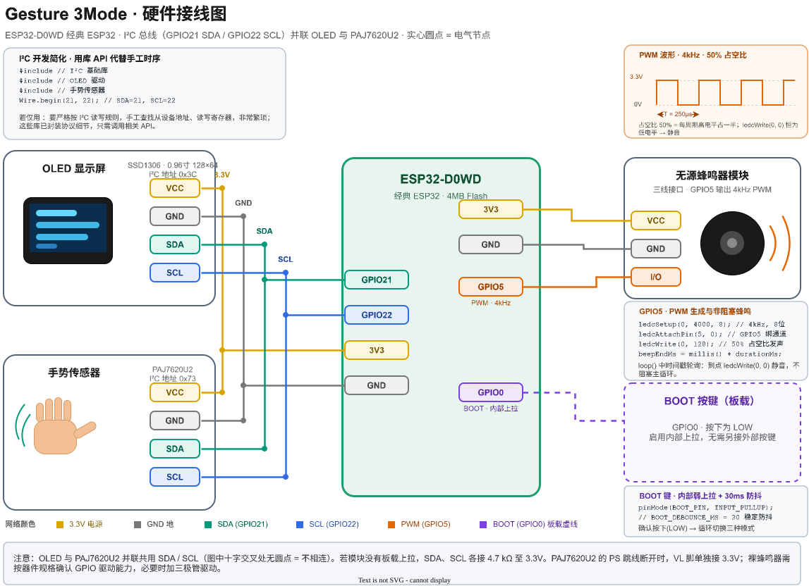
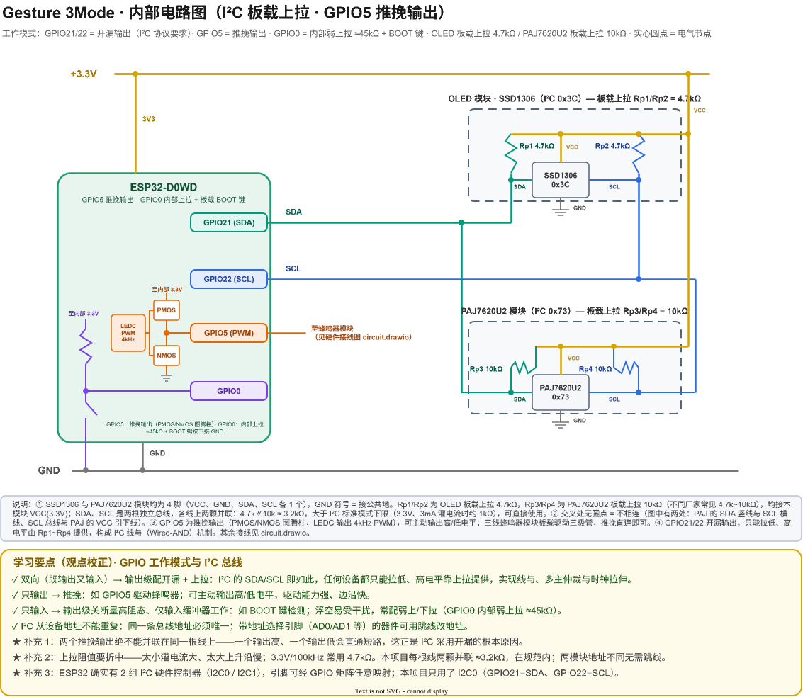
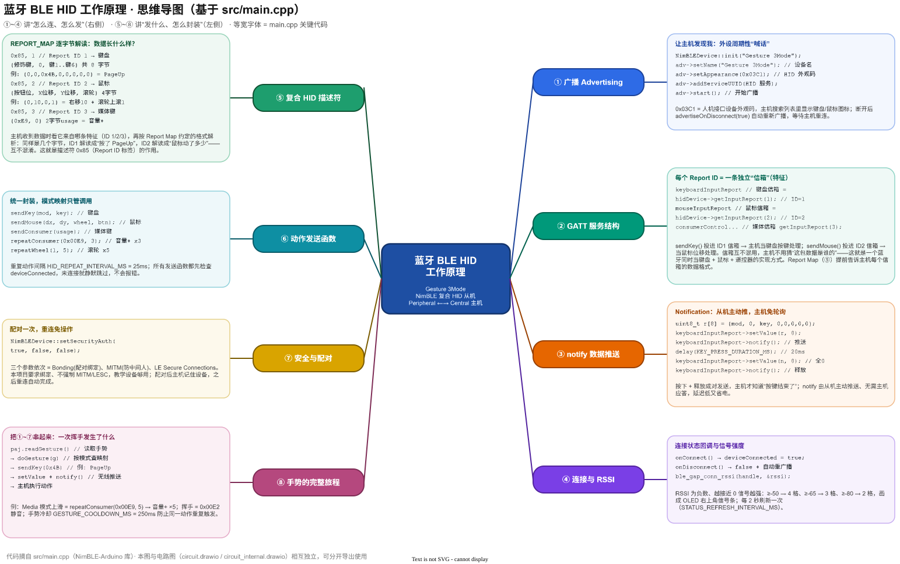
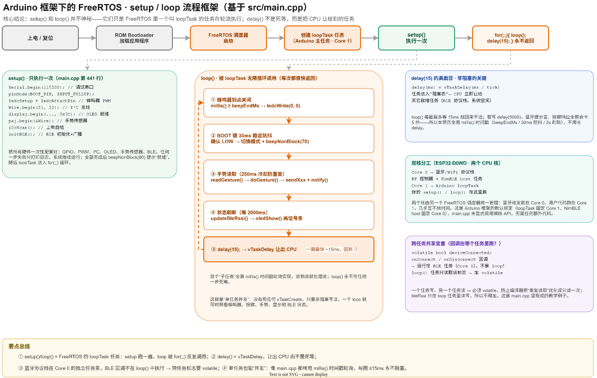

# Gesture 3Mode 原理说明书

> 手势三模式控制器：PAJ7620U2 手势识别 → ESP32-D0WD 判断与映射 → BLE HID 无线发送 → 主机执行（翻页 / 滚动 / 音量 / 播放），OLED 实时显示状态，蜂鸣器声音提示。

## 1. 作品由来与选型

- **由来**：源于对嵌入式交互的兴趣，想做集手势控制、蓝牙 HID、OLED 显示于一体的实用作品，锻炼 I²C、PWM、BLE 等综合技能。
- **MCU 选型：ESP32-D0WD**——集成 Wi-Fi 与蓝牙（BLE HID 必需），双核 + Arduino 生态适合本项目规模。
- **工具与框架**：PlatformIO（VS Code 插件）＋ Arduino 框架（底层基于 ESP-IDF + FreeRTOS）。

## 2. 硬件电路



| 模块 | 接线 |
| --- | --- |
| OLED SSD1306（0x3C） | VCC→3.3V，GND→GND，SDA→GPIO21，SCL→GPIO22 |
| PAJ7620U2（0x73） | 与 OLED 并联共用 I²C 总线 |
| 无源蜂鸣器 | I/O→GPIO5（4kHz PWM），VCC→3.3V，GND→GND |
| BOOT 键（板载） | GPIO0 内部上拉，按下为 LOW |



电气原理要点：

- **I²C 总线**：GPIO21/22 为开漏输出，高电平靠 OLED 与 PAJ7620U2 模块板载上拉电阻（Rp1~Rp4）提供，构成线与机制。
- **GPIO5**：推挽输出（PMOS/NMOS 图腾柱），LEDC 外设输出 4kHz PWM 直接驱动蜂鸣器模块。
- **GPIO0**：内部弱上拉 ≈45kΩ，BOOT 键按下拉低即可，无需外接元件。

## 3. 软件原理



设备以 NimBLE 实现**复合 HID**：一份 `REPORT_MAP` 描述符定义 Report ID 1=键盘、2=鼠标、3=Consumer（媒体键），各自对应独立 GATT 特征；手势动作经 `sendKey / sendMouse / sendConsumer` 封装后以 `notify()` 主动推送给主机。



Arduino 的 `setup()/loop()` 实际是 FreeRTOS 的 loopTask 任务（Core 1）：setup 只执行一次完成全部外设初始化；loop 用 `millis()` 时间戳轮询实现非阻塞并发（蜂鸣器定时、按键防抖、手势冷却、状态刷新），`delay(15)` 即 `vTaskDelay` 让出 CPU。

核心初始化代码：

```cpp
Wire.begin(21, 22);                    // I²C 总线
ledcSetup(BUZZER_CH, 4000, 8);         // 4kHz PWM
ledcAttachPin(BUZZER_PIN, BUZZER_CH);
NimBLEDevice::init("Gesture 3Mode");   // BLE 广播 + HID 服务
```

## 4. 收获

- 理解 I²C 电气特性（开漏、上拉、线与）与推挽输出的区别；
- 掌握 BLE HID 的 GATT / Report Map / notify 机制；
- 学会用非阻塞时间戳写法在单任务里实现"并发"；
- 练习了串口调试、PlatformIO 工程、Git 版本管理与文档维护。
